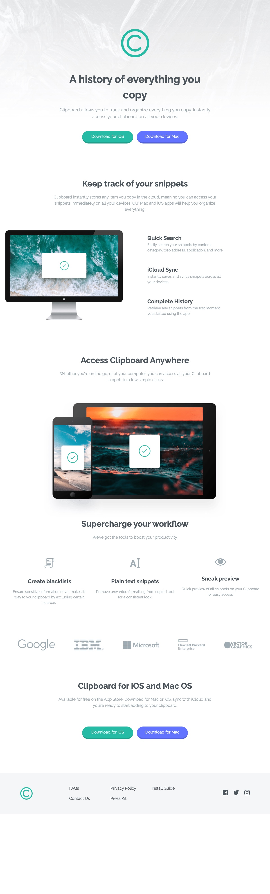
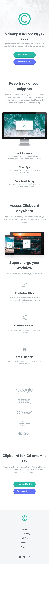

# Clipboard Landing Page

_Landing page_ estática y _responsive_ para **Clipboard**, una app ficticia de gestión del portapapeles, construida con **React 19 + TypeScript + Vite** y estilada con **SCSS Modules**. Es la solución al reto [Clipboard landing page de Frontend Mentor](https://www.frontendmentor.io/challenges/clipboard-landing-page-5cc9bccd6c4c91111378ecb9): sin estado, sin router y sin llamadas de red, cada bloque es un **componente puro** alimentado por _props_ o por datos tipados.

**Demo:** [clipboard-landing-page-tau-ecru.vercel.app](https://clipboard-landing-page-tau-ecru.vercel.app)


| Escritorio                                                                        | Móvil                                                                       |
| --------------------------------------------------------------------------------- | --------------------------------------------------------------------------- |
|  |  |

---

## Tabla de contenidos

- [Clipboard Landing Page](#clipboard-landing-page)
  - [Tabla de contenidos](#tabla-de-contenidos)
  - [Qué hace el proyecto](#qué-hace-el-proyecto)
  - [Cómo ejecutar el proyecto](#cómo-ejecutar-el-proyecto)
    - [Requisitos](#requisitos)
    - [Instalación](#instalación)
    - [Scripts](#scripts)
  - [Cómo funciona](#cómo-funciona)
    - [1. `src/App.tsx`](#1-srcapptsx)
    - [2. Componentes (`src/components`)](#2-componentes-srccomponents)
    - [3. Datos tipados (`src/common`)](#3-datos-tipados-srccommon)
    - [4. Estilos (`src/styles`)](#4-estilos-srcstyles)
    - [Flujo de renderizado](#flujo-de-renderizado)
  - [Cómo extenderlo](#cómo-extenderlo)
  - [Calidad y CI](#calidad-y-ci)
  - [Tecnologías](#tecnologías)
  - [Estructura del proyecto](#estructura-del-proyecto)
  - [Personalización](#personalización)
  - [Licencia](#licencia)

---

## Qué hace el proyecto

- **Página completa en un único árbol de componentes**: cabecera, botones de descarga, secciones de texto, características, dispositivos, bloque informativo, logos de clientes y footer.
- **Componente `Section` reutilizable** (`title` + `content`), usado cuatro veces.
- **`Button` con variantes** `primary` / `secondary` que reenvía las _props_ nativas de `<button>`.
- **Footer dirigido por datos**: enlaces y redes sociales definidos como arrays tipados, no como JSX.
- **Diseño _responsive_** con _breakpoints_ SCSS (`$phone`, `$tablet`, `$small-desktop`…) y fondos de cabecera distintos para escritorio y móvil.
- **SCSS Modules por componente** más una capa global de colores, _breakpoints_ y _mixins_ accesible con el alias `@styles`.
- **TypeScript estricto** (`noUnusedLocals`, `noUnusedParameters`).

---

## Cómo ejecutar el proyecto

### Requisitos

| Herramienta | Versión                       |
| ----------- | ----------------------------- |
| Node.js     | `>= 22` (la CI usa Node 24)   |
| Yarn        | 1.x (Classic, `yarn.lock` v1) |

### Instalación

```bash
git clone git@github.com:EdouardoCornejo/clipboard-landing-page.git
cd clipboard-landing-page
yarn install
yarn dev
```

Vite sirve la app en `http://localhost:5173`.

### Scripts

| Comando             | Comando real                                                   | Qué hace                                                    |
| ------------------- | -------------------------------------------------------------- | ----------------------------------------------------------- |
| `yarn dev`          | `vite`                                                         | Servidor de desarrollo con HMR.                             |
| `yarn build`        | `tsc -b && vite build`                                         | Comprueba tipos y genera el build de producción en `dist/`. |
| `yarn preview`      | `vite preview`                                                 | Sirve localmente el `dist/` ya generado.                    |
| `yarn lint`         | `eslint . --report-unused-disable-directives --max-warnings 0` | Lint de todo el repo; falla con cualquier warning.          |
| `yarn format:fix`   | `prettier --write .`                                           | Formatea todos los archivos.                                |
| `yarn format:check` | `prettier --check .`                                           | Comprueba el formato sin escribir (lo usa la CI).           |
| `yarn prepare`      | `husky`                                                        | Instala los Git hooks; se ejecuta solo tras `yarn install`. |

---

## Cómo funciona

### 1. `src/App.tsx`

`main.tsx` monta `<App />` en `<StrictMode>`, y `App` compone la página entera colocando los bloques dentro de `PageLayout`. Los textos llegan como _props_ (`Section`, `Button`).

### 2. Componentes (`src/components`)

Cada componente es una carpeta con su `index.tsx` y su `*.module.scss`, re-exportados desde `src/components/index.ts`:

- **`layout/rootLayout` (`PageLayout`)** — contenedor `<main>` que envuelve el contenido y añade el `Footer` con `linksData` y `socialData`.
- **`layout/header` (`Header`)** — logo, titular y fondo decorativo.
- **`layout/footer` (`Footer`)** — recorre los arrays de enlaces y redes sociales recibidos por _props_.
- **`downloadButtons` (`DownloadBtn`)** — "Download for iOS" (`primary`) y "Download for Mac" (`secondary`).
- **`form/button` (`Button`)** — botón con variante de color.
- **`section` (`Section`)** — título + párrafo.
- **`features` (`Features`)** — imagen de ordenador con Quick Search, iCloud Sync y Complete History.
- **`devices` (`Devices`)** — imagen de dispositivos.
- **`infoSection` (`InfoSection`)** — Create blacklists, Plain text snippets y Sneak preview.
- **`logos` (`Logos`)** — logos de Google, IBM, Microsoft, HP y Vector Graphics.

### 3. Datos tipados (`src/common`)

`common/data/footer.ts` define `linksData` y `socialData`, tipados con las interfaces `Links` y `Social` de `common/interfaces/footer.ts`.

### 4. Estilos (`src/styles`)

`index.scss` agrupa `colors`, `mixins`, `variables` (_breakpoints_) y `global` (reset y fuentes de Google Fonts). Los módulos los importan con `@import '@styles';`, alias definido en `vite.config.ts`.

### Flujo de renderizado

```
main.tsx
  └─ <App />
       └─ PageLayout
            ├─ Header
            ├─ DownloadBtn ── Button (primary) + Button (secondary)
            ├─ Section ("Keep track of your snippets")
            ├─ Features
            ├─ Section ("Access Clipboard Anywhere")
            ├─ Devices
            ├─ Section ("Supercharge your workflow")
            ├─ InfoSection
            ├─ Logos
            ├─ Section ("Clipboard for iOS and Mac OS")
            ├─ DownloadBtn
            └─ Footer ← linksData + socialData
```

---

## Cómo extenderlo

**Añadir un bloque visual nuevo** (4 sitios, 5 si lleva imágenes):

1. Crea `src/components/myBlock/index.tsx` con `export const MyBlock = () => { ... }`.
2. Crea `src/components/myBlock/my-block.module.scss`, empezando con `@import '@styles';` si necesitas los _tokens_.
3. Añade `export * from './myBlock';` a `src/components/index.ts`.
4. Importa `MyBlock` y colócalo en `src/App.tsx`.
5. Si tiene imágenes, guárdalas en `src/assets/` e impórtalas desde su `index.tsx`.

**Añadir una sección de texto**: reutiliza `Section` en `App.tsx`:

```tsx
<Section title="Tu título" content="Tu texto." />
```

**Añadir un enlace o red social al footer**: agrega un objeto con `id` único a `linksData` o `socialData` en `src/common/data/footer.ts`; para una red social, guarda el SVG en `src/assets/svg/` e impórtalo como `icon`.

---

## Calidad y CI

- **Lint** — `eslint.config.js` (flat config): `@eslint/js` recomendado, `typescript-eslint` con reglas _type-checked_, React Hooks y React Refresh, `enum` y `namespace` prohibidos, imports de tipos separados y 0 warnings.
- **Formato** — Prettier (`.prettierrc.json`: `printWidth: 100`, comillas simples, `trailingComma: all`).
- **Pre-commit** — `.husky/pre-commit` ejecuta `lint-staged` (ESLint `--fix` + Prettier sobre los archivos en _stage_) y luego `yarn build`.
- **CI** — `.github/workflows/ci.yml` corre en cada push y PR a `main` con Node 24: `format:check` → `lint` → `build`. Solo verifica, no despliega.
- **Deploy** — `vercel.json` desactiva el auto-deploy desde Git (`deploymentEnabled: false`); el despliegue en Vercel es manual.

---

## Tecnologías

- **React 19** + **TypeScript 5.9**
- **Vite 7** — desarrollo, build y alias `@styles`.
- **Sass (`sass-embedded`)** — SCSS Modules por componente.
- **Google Fonts** — Bai Jamjuree.
- **ESLint 10**, **Prettier 3**, **Husky**, **lint-staged** — calidad de código.

---

## Estructura del proyecto

```
clipboard-landing-page/
├── .github/workflows/ci.yml
├── .husky/pre-commit
├── docs/                         # Capturas del README
├── public/
│   ├── favicon.svg               # Favicon
│   ├── favicon.ico               # Favicon de respaldo
│   └── apple-touch-icon.png      # Icono de inicio en iOS
├── src/
│   ├── assets/
│   │   ├── png/                  # Fondos, imágenes y logos de clientes
│   │   └── svg/                  # Logo e iconos
│   ├── common/
│   │   ├── data/footer.ts        # linksData, socialData
│   │   └── interfaces/footer.ts  # Links, Social
│   ├── components/
│   │   ├── devices/
│   │   ├── downloadButtons/
│   │   ├── features/
│   │   ├── form/button/
│   │   ├── infoSection/
│   │   ├── layout/               # footer, header, rootLayout
│   │   ├── logos/
│   │   ├── section/
│   │   └── index.ts
│   ├── styles/                   # colors, global, mixins, variables + index.scss
│   ├── App.tsx
│   ├── index.css
│   ├── normalize.css
│   └── main.tsx
├── eslint.config.js
├── index.html
├── vercel.json
├── vite.config.ts
└── package.json
```

---

## Personalización

| Qué                | Dónde                                      | Valor por defecto                                          |
| ------------------ | ------------------------------------------ | ---------------------------------------------------------- |
| Color primario     | `$primary` en `styles/colors/_colors.scss` | `#26bba4`                                                  |
| Color secundario   | `$secondary`                               | `hsl(233, 100%, 69%)`                                      |
| _Breakpoints_      | `styles/variables/_variables.scss`         | `576px`, `768px`, `900px`, `1150px`, `1600px`              |
| Enlaces del footer | `linksData` en `common/data/footer.ts`     | FAQs, Privacy Policy, Install Guide, Contact Us, Press Kit |
| Redes sociales     | `socialData`                               | Facebook, Twitter, Instagram                               |

---

## Licencia

Sin licencia explícita. Proyecto personal de práctica basado en el [reto Clipboard landing page de Frontend Mentor](https://www.frontendmentor.io/challenges/clipboard-landing-page-5cc9bccd6c4c91111378ecb9); el diseño y los recursos gráficos pertenecen a Frontend Mentor.
